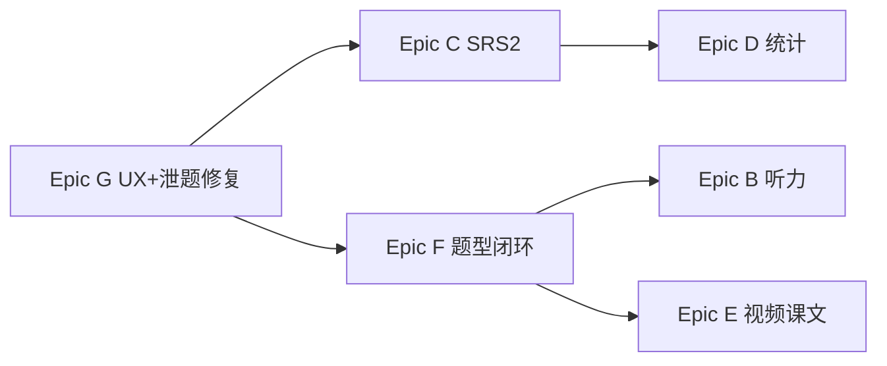

# 日语学习产品主文档（唯一）

## 1. 需求快照（持续更新）
- 产品形态：平板 App 体验优先，桌面与手机浏览器可直接打开。
- 安装要求：用户无需安装任何编程环境或插件。
- 视觉体验：温馨治愈黄色系为主、辅以薄荷/腮红点缀；统一动效与玻璃拟态卡片、强可读性。
- 学习主流程：导入课文 -> 圈选创建词卡/句译/语法题 -> 按遗忘曲线练习。
- AI 功能：语法题选项与详解、词卡辅助字段生成、课文独立聊天（快速/思考）。
- 聊天策略：每篇课文独立会话，请求仅带最近 5 轮上下文，历史完整保存。
- 数据策略：首版本地优先 + 导入导出；**远期**云端见 **§15.2 Iter 23**（GitHub + Vercel + Supabase，朋友用 URL 访问；账号登录后数据在云上）。
- 激励机制：清晨与夜间展示文言古训激励语，每句不少于 15 字。

## 2. 架构与模块
- `src/app`: 页面路由与布局。
- `src/modules/learning`: 课文、词卡、题目创建与练习逻辑。
- `src/modules/srs`: 遗忘曲线调度与熟练度更新。
- `src/modules/chat`: 课文聊天会话管理。
- `src/modules/ai`: AI 代理调用、结构化响应解析与回退策略。
- `src/modules/storage`: 本地持久化与导入导出。
- `src/modules/cloud`: Supabase 浏览器客户端、`user_app_data` 读写（Iter 23）；与 `storage` 并行演进。
- `src/modules/stats`：`statsAggregation` / `statsCsv`；**`statsDueBreakdown`**（全库与按课文待刷）；**`statsTabLocalPrefs`**（统计页 UI 本地偏好）。
- `src/shared`: 主题、组件、工具函数、类型定义。

## 3. 迭代看板（待办）
- [x] Iteration 0A: 初始化主文档与模板
- [x] Iteration 0B: Next.js + TypeScript + Tailwind + PWA 骨架
- [x] Iteration 1: 课文导入与词卡体系
- [x] Iteration 2: 三类练习与遗忘曲线
- [x] Iteration 3: AI 出题、详解与语音
- [x] Iteration 4: 课文独立聊天
- [x] Iteration 5: 激励系统、导入导出、鲁棒性与性能验收
- [x] Iteration 10: 课文信息架构（导入弹层、拖拽序列、编辑、聊天入口收敛）— 详见 §14
- [x] Iteration 11: 单词/练习信息架构（词卡列表与排序筛选、新建/出题弹层）— 详见 §14–§15
- [x] Iteration 12: 词卡 AI 补全 + 课文例句规则截取 — 详见 §14
- [x] Iteration 13: 课文阅读内划选 → 句子题 / 语法题入库 — 详见 §14
- [x] Iteration 13.1: 词卡 AI 读音写入アクセント数字型；语法出题优先 Pro 模型并强化错项解析提示词 — 见 §5 变更记录
- [x] Iteration 13.2: 修复首页 hydration（`loadData`/激励语仅客户端注入）— 见 §5 变更记录
- [x] Iteration 13.3: 词卡搜索、练习队列统计、浏览器朗读（划选/首行/详情）；KittenTTS 安装说明写入 `kittentts/README.md` — 见 §5
- [x] Iteration 13.4: 课文分句朗读面板（连续播放、点句跳转、高亮）、导出分句 txt；练习「单词题自动朗读」开关（localStorage）；说明浏览器无法导出 MP3 — 见 §5
- [x] Iteration 13.5: 课文作者字段（空则存「著者不明」）、`updatedAt` 与列表排序、导入 JSON 二次确认、首帧持久化 `queueMicrotask` — 见 §5
- [x] Iteration 13.6: 课文阅读「阅读 / 跟读」双模式；跟读无序号句卡 + 行译映射 — 见 §5（宽屏双栏已按需求改为单列跟读）
- [x] Iteration 13.7: 词源多行展示；词卡入库即含 AI 三道干扰项；练习页单词固定四选一、句子固定拖拽组句、语法四选一动效与音效 — 见 §5
- 后续 **14+** 见 **§13、§15.2–15.3**（全译配图、Backlog 池）
- **2026-04-16**：练习深化、SRS 2.0、统计、听力、视频课文等 **§16 Epic + 迭代顺序**（执行时以 §16 为准）
- [x] **2026-04-17**：顶栏 **「统计」** 独立页 + 按课文待复习表（见 §5 Iteration 16-stats-tab）
- [x] **Iteration 15-listening（MVP）**：课文音频上传/播放 + 一键生成听力句子题（见 §5）
- [x] **Iteration 18-srs（收尾）**：未到期保护、脏数据阶段归一、已毕业防复活（见 §5）
- [x] **Iteration 17-video-lesson（MVP）**：视频 URL + SRT 分段 + 跟读点句 seek（见 §5）
- [x] **Iteration 19-content-practice（收尾）**：句题 token 稳定化 + 新词四连闭环 + 语法原句上下文（见 §5）
- [x] **Iteration 20-practice-ux（收尾）**：填空题 **一键提交判分**（与选择题「确认→下一题」区分）；见 §5
- [x] **Iteration 16-stats（收尾）**：统计页偏好 **localStorage**、**摘要 CSV**、待刷聚合 **`statsDueBreakdown`**；见 §5
- [x] **Iteration 23-cloud（代码侧 MVP+）**：Supabase Auth + **`user_app_data` 整包 / 增量 RPC / 三选一合并 / 合并前 id 摘要** + **`docs/CLOUD_SETUP.md`**；**仍属用户侧**：在 **ShouzhiLPB** 建库、Vercel 填 env、真机走 `/qa`（见 §5 Iter 23 段内说明）

## 4. 每轮执行模板（先文档后编码）
### 4.1 本轮目标
- 目标：
- 验收标准：
- 风险点：

### 4.2 编码前检查
- 已阅读当前文档：是 / 否
- 是否调整范围：是 / 否（说明）
- 是否新增文档：否（默认）

### 4.3 编码后回写
- 完成项：
- 未完成项：
- 技术债：
- 下轮边界：

## 5. 变更记录
### 2026-04-17 / 云轮次 1：空本机防冲云端（上传 + 自动同步）
- **实现**：`learningCoreEntryCount`、`shouldBlockSyncThatWouldWipeRemoteCore`、`payloadDeltaHasEmptyMainArray`（`cloudUserAppData.ts`）；`CloudAuthPanel` 手动上传拦截；`page.tsx` 自动同步在「空核心 + 云端有资料」时跳过危险 **upsert** / 含空主数组的 **RPC**，RPC 失败回退整包时亦跳过；**§17.6** 轮次计划表。
- **单测**：`cloudUserAppData.test.ts`。
- **文档**：§17.5 百分比微调。

### 2026-04-17 / 云轮次 2～4 收口（§17.6 表内「可交付」项）
- **轮次 2**：`pruneOrphanLessonScopedEntries`（`dataStore.ts`）并入 `normalizeAppData`，去掉 `lessonId` 已不在 `lessons` 中的词卡 / 句题 / 语法题 / 聊天 / 笔记 / 收藏句；`dataStore.test.ts`。
- **轮次 3**：合并弹层「同 id 课文」JSON 对比下增加 **正文逐行并排**（`mergeLessonContentLineDiff.tsx` + `tryLessonContentPairFromNormJson`）；`mergeLessonContentLineDiff.test.ts`。
- **轮次 4**：`e2e/smoke.spec.ts` 断言 `/qa` 含 **「二、云端与弱网」** 清单标题。
- **文档**：§17.6 表改为带 **状态** 列并勾选四轮；**余量**（整段 RPC 按 id patch、Myers/redline 全文 diff、真机农场）仍在 §17.2 / §17.4。

### 2026-04-17 / 云轮次 5：课文标题/正文小字段 RPC + 阅读器防抖上云
- **实现**：迁移 **`jp_learn_patch_lesson_payload`**；`patchLessonPayloadInCloud`（`cloudUserAppData.ts`）；`page.tsx` 阅读器 `onPersistLesson` 合并 **`name` / `content` / `updatedAt`** 后 **2.5s 防抖** 调 RPC，成功后写 **指纹包 + lastSeen**。
- **单测**：`cloudUserAppData.test.ts`（RPC 名、未部署、空 patch、成功返回）。
- **文档**：`CLOUD_SETUP.md` 增加第 6 条迁移；§17.2 / §17.5 / §17.6 对齐「首版字段 patch」。

### 2026-04-17 / 云轮次 5 续：课文 patch 白名单扩展（阅读器常用字段）
- **实现**：迁移 **`20260426120000_jp_learn_patch_lesson_payload_extend.sql`**（`CREATE OR REPLACE` 同一 RPC）；`LessonPayloadCloudPatch`、`pickLessonPayloadCloudPatch`；`patchLessonPayloadInCloud` 与 **`page.tsx`** 防抖路径覆盖 **分类/作者/行译/显隐/媒体键与外链/视频轴/废纸篓** 等。
- **单测**：`pickLessonPayloadCloudPatch` 行为用例。
- **文档**：`CLOUD_SETUP.md` 第 6 条下补充 **2612** 说明。

### 2026-04-17 / 云轮次 6：词卡字段 patch RPC + 练习 SRS / 编辑防抖上云
- **实现**：迁移 **`20260427120000_jp_learn_patch_vocab_card_payload.sql`**；`patchVocabCardPayloadInCloud`、`VocabPayloadCloudPatch`；**`page.tsx`** 词卡「保存修改」与 **`submitAnswer`** 中词卡 SRS 更新走 **2.5s 防抖** + 指纹 / lastSeen。
- **单测**：`PATCH_VOCAB_CARD_PAYLOAD_RPC`、未部署 RPC、空 patch。
- **文档**：`CLOUD_SETUP.md` 第 7 条；§17.5 / §17.6 / §17.2 i2-4 行。

### 2026-04-17 / 云轮次 7：句题 + 语法题字段 patch RPC + 练习 / 详情防抖上云
- **实现**：迁移 **`20260428120000_jp_learn_patch_sentence_and_grammar_task_payload.sql`**（`jp_learn_patch_sentence_task_payload`、`jp_learn_patch_grammar_task_payload`）；`patchSentenceTaskPayloadInCloud`、`patchGrammarTaskPayloadInCloud`；**`page.tsx`** 句题/语法 **保存修改** 与 **`submitAnswer`** 中对应 SRS 防抖写云。
- **单测**：RPC 名 + 未部署时 `null`。
- **文档**：`CLOUD_SETUP.md` 第 8 条；§17.5 / §17.6 / §17.2 i2-4 行。

### 2026-04-17 / 云轮次 8：课文笔记 + 收藏句上云（patch + 子树 merge）
- **实现**：迁移 **`20260429120000_jp_learn_patch_lesson_note_and_favorite_sentence.sql`**；`patchLessonNotePayloadInCloud` / `patchFavoriteSentencePayloadInCloud`；**`page.tsx`** 笔记 **保存** 走 patch 防抖；笔记/收藏 **新建与删除** 走 **`mergePayload_delta`** 整段子树防抖合并。
- **单测**：两 RPC 名 + 未部署 `null`。
- **文档**：`CLOUD_SETUP.md` 第 9 条；§17.5 / §17.6 / §17.2 i2-4 行。

### 2026-04-17 / 云轮次 9：课内聊天会话子树防抖上云（merge）
- **实现**：无新 SQL；沿用 **`jp_learn_merge_payload_delta`** 的 **`chatSessions`**（须已跑 **`20260423140000_…`**）；**`page.tsx`**：`scheduleChatSessionsCloudSubtreeMerge` — 发消息、AI 结束、`renameSessionTo`、`createNewEmptyChatSession`、`deleteSession` 后 **2.5s 防抖** 写云 + 指纹 / lastSeen。
- **文档**：`CLOUD_SETUP.md` §1 说明；§17.5 / §17.6 / §17.2 i2-4 行。

### 2026-04-17 / i2-6 收口：`/qa` 换机清单 + 主流手机逻辑宽度矩阵
- **实现**：`i2AcceptanceChecklists.ts` 新增 **`I2_DEVICE_SWITCH_ACCEPTANCE`**、**`I2_PHONE_VIEWPORT_MATRIX_ACCEPTANCE`**（`PHONE_VIEWPORT_PRESETS`：360×800、375×667、390×844、414×896、428×926、横屏 844×390）；手机布局清单补 **课内聊天** 一条；**`/qa`** 展示「一附 / 一附二」并说明与根目录 **`npm run verify`** 的关系。
- **单测**：`i2AcceptanceChecklists.test.ts` 覆盖新块非空。
- **文档**：§17.2 **i2-6** 行。

### 2026-04-17 / `CLOUD_SETUP`：§4.1 补充「Vercel Status: Ready = 已上线」说明
- **内容**：Deployments 里 **Ready + Production** 即成功；示例域名说明为「以你项目为准」。

### 2026-04-17 / `CLOUD_SETUP`：§4.1「SQL 与 Vercel 变量都弄完以后」检查清单
- **内容**：提醒 **Redeploy**、可选 Redirect URL、可选 `NEXT_PUBLIC_CLOUD_*` 与 2 分钟线上验收；§6 表述与 §17 增强项对齐。

### 2026-04-17 / 云合并：白话差异摘要 + 部署「只有你能做」说明（§0）
- **实现**：`humanMergeConflictHints`（`cloudMergeHumanDiff.ts`）在合并弹层逐条冲突下展示人话对比；`CLOUD_SETUP.md` 新增 **§0**（不懂数据库时的分工表）。
- **单测**：`cloudMergeHumanDiff.test.ts`。

### 2026-04-17 / 云合并：同 id 冲突逐条挑选（本机 / 自动 / 云端）
- **实现**：`mergeAppDataLocalAndRemote(local, remote, conflictPicks?)` 第三参 `MergeConflictPicks`；`CloudAuthPanel` 对齐弹层对冲突 id 提供三态按钮（每类最多展示 48 条 + 滚动，超出请筛选）；Vitest 覆盖「强制本机胜过较新云端」。
- **文档**：§17.2 / §17.4 / §17.5、`CLOUD_SETUP`、`i2AcceptanceChecklists` 同步。

### 2026-04-17 / 云存档：下载云端 JSON 副本 + 合并摘要 id 筛选 + 云端操作分阶段提示
- **实现**：`CloudAuthPanel` 增加 **「下载云端 JSON 副本」**（`fetchUserAppDataFromCloud` + Blob 下载；`cloudBackupDownload.ts` 负责文件名与缩进 JSON）；合并弹层摘要增加 **关键词筛选**（`filterIdsBySubstring` 于 `cloudMergePreview.ts`）；上传 / 拉取对齐 / 下载 / 三选一写入时 **按钮文案分阶段提示**（`cloudOp` + `cloudPhaseHint`）。
- **单测**：`cloudMergePreview.test.ts`、`cloudBackupDownload.test.ts`。
- **文档**：`CLOUD_SETUP.md` §5、`i2AcceptanceChecklists.ts` 弱网节；主文档 **§17.4 / 新增 §17.5**（里程碑式完成度百分比表）。

### 2026-04-16 / 统计未来窗口 7 / 15 日（移除 30 日）
- **原因**：SRS 单次最长间隔 **14 天**，30 日横轴信息冗余。
- **实现**：`StatsFutureHorizonPreset` 仅保留 **`d7` | `d15`**（含今日共 7 或 15 个日历日）；默认 **15 日**；`localStorage` 键 `jpLearn_statsFutureHorizon` 持久化选择，旧存 **`d14` / `d30` 自动迁为 `d15`**。

### 2026-04-16 / 统计「未来刷题计划」今日行口径修复
- **现象**：未来图**第一日（今日）**词 / 句 / 法计数为 0，但练习侧「今日待刷」非零。
- **原因**：原先用「排期日历日 **等于** 当日」计数，**逾期未刷**（`nextReviewDay` 早于今日）被排除，与 **`filterDueReviewItems`**（`排期日 ≤ 今日`）不一致。
- **实现**：`statsAggregation.ts` 新增 **`countDueThroughCalendarDay`**；**仅今日行**改用「未毕业且排期日 ≤ 今日」；**明日及以后**仍为「排期日恰好落在该日」。单测覆盖逾期 + 与 `filterDueReviewItems` 对齐；统计页文案与 **`StatsTrendCharts` FutureTooltip** 已说明差异。

### 2026-04-16 / Iteration 23-cloud（代码侧已对齐产品 MVP+）
- **目标**：朋友通过 **公开网址** 使用本应用；**免费层** 部署；**数据以云端为主**（最终态）；**你要做的部署步骤**见 **`docs/CLOUD_SETUP.md`**（示例 GitHub 用户 **ShouzhiLPB**、Vercel Root **`app`**）。
- **已落地（代码）**：
  - **`@supabase/supabase-js`**；`modules/cloud/supabaseBrowserClient.ts`；`modules/cloud/cloudUserAppData.ts`（整包读写、指纹包、`planCloudAutoSync`、RPC 增量合并等，写入前 **`normalizeAppData`**）。
  - **SQL**：`app/supabase/migrations/` 下 **`user_app_data`** 与 **`jp_learn_merge_payload_delta`** 演进脚本（见 `CLOUD_SETUP.md` 顺序表）。
  - **「数据」页** `CloudAuthPanel`：注册 / 登录 / 退出；**上传到云端**；**从云端对齐（三选一）** 弹层 + **`mergeAppDataLocalAndRemote`** + **合并前 id 摘要**（`cloudMergePreview.ts`）；展示云端 `updated_at`。
  - Vitest：云模块相关单测（含合并 / 预览 / 自动同步计划）。
- **仍待办（多为运维 / 远期）**：在 **ShouzhiLPB** 下建仓库并 **push**；**Vercel** 导入仓库、填环境变量、**Root Directory = `app`**；**Iter 21** 与云端 **双写** 草案；可选 **未登录路由门禁**；超大 `coverIllustrationDataUrl` 行体积优化；**真机矩阵**见 i2-6。
- **仓库 / 托管**：GitHub + Vercel；环境变量见 `app/.env.example`（**勿**暴露 `service_role`）。
- **验收（草案）**：换设备同账号可对齐云端；未登录不可读他人 `user_app_data` 行（RLS）。

### 2026-04-17 / Iteration 18-srs（MVP）
- **SRS 2.0**：词卡 / 句题 / 语法题增加 `reviewStage`（0–4）、`nextReviewDay`（本地 `yyyy-MM-dd`）、`reviewGraduated`；答对按 **0→+1→+3→+7→+14 天** 推进；**「太简单」直接毕业**（`patchAfterCorrect(..., "easy")`）；stage 4 再答对即毕业不出队；答错 **降一档** 并按上一档间隔从 **今日** 起算下次出现日；**同日待刷按 `createdAt` 升序**（先建的先刷）。
- **答错立即重练**：练习页 `practiceRepeatPin` 将本题钉在当日队列队首；换课文或题型时清除。
- **同形异义**：`upsertVocabWithPolysemyReset` 合并新义项时 **SRS 与熟练度一并清零**。
- **旧数据**：`normalizeAppData` 为缺字段条目补全 SRS；`calendarTodayLocal` / `addCalendarDaysLocal` 在 `shared/utils.ts`。

### 2026-04-17 / Iteration 18-srs（收尾）
- **未到期保护**：`patchAfterCorrect` 新增 `isReviewDue` 守卫；条目未到 `nextReviewDay` 时返回 `null`，避免误触把未来题提前推进。
- **防脏数据**：新增 `normalizeReviewStage`，将异常阶段值收敛到 `0..4`；`patchAfterCorrect` / `patchAfterWrong` 使用归一化阶段。
- **防复活**：`patchAfterWrong` 对已毕业条目返回保持毕业状态的 patch，避免异常调用把 `reviewGraduated` 复位为 `false`。
- **单测**：`scheduler.test.ts` 增加上述场景（未到期、已毕业答错、阶段归一、`isReviewDue` 口径）覆盖。

### 2026-04-17 / Iteration 15-listening（MVP）
- **课文音频源**：`Lesson` 新增 `listeningAudioDataUrl`；课文阅读顶部支持**上传音频 / 移除音频**（本地 data URL，导入导出随数据走）。
- **跟读播放**：跟读模式新增 `audio` 播放器（读取课文上传音频），与浏览器 TTS 可并行使用。
- **听力入库闭环**：新增「一键生成听力句子题」——按 `splitLessonIntoSentenceSpans` 扫描本课分句，去重后批量 `createSentenceTask` 入库（题面优先用覆盖行译文，缺失时回退 `听写练习：第N句`）。
- **交互反馈**：生成数量/跳过数量即时提示，便于重复执行时确认是否已全量入库。

### 2026-04-17 / Iteration 17-video-lesson（MVP）
- **数据模型**：`Lesson` 新增 `videoSourceUrl` / `videoCues`（`startSec/endSec/text`），用于视频课文与句卡跳转。
- **工具**：`parseSrtToVideoCues`（`shared/utils.ts`）支持 SRT → cue 解析（坏块跳过、按时间排序），`utils.test.ts` 增加解析单测。
- **阅读器配置**：`LessonReaderPanel` 新增「配置视频课文」弹层，可保存视频 URL 与 SRT；支持一键清空配置。
- **跟读行为**：跟读模式出现 `video` 播放器；点击句卡优先按同序 cue `seek` + `play` 视频；视频模式下不依赖浏览器 TTS。
- **状态反馈**：保存成功/未配 cue 等即时提示；无 cue 时点句仅高亮并提示补 SRT。

### 2026-04-17 / Iteration 19-content-practice（收尾）
- **句题拖拽闭环**：新增 `tokenizeSentenceForDrag`（`shared/utils.ts`）：有空格按空格切词；无空格回退逐字符 token，确保拖拽组句不出现“整句单块不可拖”的伪题。
- **入库应用**：`createSentenceTask` 改为统一调用 `tokenizeSentenceForDrag`，对 AI 返回无空格 `jpAnswer` 也能直接进入拖拽练习。
- **单测**：`utils.test.ts` 覆盖两类分词；`lessonService.test.ts` 覆盖无空格句题入库后 token > 1 且可还原原句。
- **新词四连闭环（最小集）**：`page.tsx` 新增本地进度（`LS_VOCAB_DRILL_PROGRESS` / `LS_VOCAB_DRILL_COMPLETED`）。新入库词在选择题下固定执行 4 步：中→日、日→中各两次；完成后回退原稳定随机方向。旧词默认视作已完成，不改变既有体验。
- **语法题上下文展示**：`GrammarTask` 新增 `sourceSentence`；练习区语法题显示「原句 + 知识点」，阅读器创建语法题时可编辑并写入来源原句，形成「出题→练习」语境闭环。

### 2026-04-17 / Iteration 20-practice-ux（Epic G 续）
- **自动判分**：单词四选一、语法四选一、句子拖拽组句在「确认答案」后再按主按钮时，与题库比对并调用 `submitAnswer("correct"|"wrong")`；**语法 / 句子全文填空 / 单词填空**的比对逻辑见下「单词填空判分」及 `isGrammarOrSentenceFillCorrect`。**填空题交互收尾**（一键「提交判分」、不再二次确认）见同日主标题 **「Iteration 20-practice-ux（收尾 · 填空一键判分）」**。
- **快捷键 1–4**：闪动键与选项按钮一致（`v_` / `vz_` / `g_`）。
- **工具**：`normalizePracticeWhitespace`（`shared/utils.ts`）；`dev:clean` 与 `next.config` 稳定性见前序提交。
- **判错反馈**：自动判错时 `submitAnswer("wrong", { wrongHint })` 展示正解文案；**四选一**另对正解格 **脉冲 + 约 2.6s 绿色环**（`practiceSolutionKey`）。
- **句子**：组句题自动判错时 **`SentenceDragComposer` 内约 3.2s 展示参考词序**（`revealSolutionOrder`）；句子**全文填空**判错时在输入框下短时展示 **`jpAnswer`**（`sentenceSolutionReveal`）。
- **判错**：手动「判错」与自动判错共用 **`primeWrongRevealHints`**（四选一正解环 + 句子正解条）。
- **单词填空判分**：`normalizeJaTermForPractice` / `normalizeZhMeaningForPractice`（`shared/utils.ts`）；**日→中填空** 与 **卡片 `meanings[]` 中任一条义项** 宽松比对。
- **统计 MVP**：`AppData.stats`（判对 / 判错 / 太简单累计），`submitAnswer` 每次写入；首页与练习页展示；`bumpPracticeMarkStats` + `normalizeAppData` 规范化（`dataStore.ts`）。
- **按日统计**：`stats.daily[yyyy-MM-dd]` 单日桶（刷题三计数 + 两类停留）；`bump` / `merge` 与全时期累计**双写**；`normalizeStats` 清洗并按约 **400 天**裁剪旧键；**统计**页过往区间含今日 / 近7 / 14 / 30 / 60 / 90 / 有记录以来，「有记录以来」可再截**图中尾部** 30/60/90/180 天；**按日 / 按周（周一至周日）**横轴；**柱+折线 / 仅柱状**（与未来图**同色三叠柱**）；**未来刷题计划**窗口为**今日起 7 日或 15 日**（SRS 最长间隔 14 天，15 日覆盖整档；已移除 30 日选项），见 `StatsFutureHorizonPreset`；**未来图今日列**与 **`filterDueReviewItems`** 一致（含逾期未刷），**明日起各列**为排期日恰好落在该日（见 §5「2026-04-16 / 统计未来计划今日行口径修复」）。
- **停留时长**：`dwellLessonReaderSec`（课文阅读全屏 + 页面前台）、`dwellPracticeSec`（练习标签 + 前台）；每秒累计，`visibilitychange` 隐藏或满 30s 经 `mergeDwellSecondsIntoStats` 写入；首页/练习页展示可读时长。
- **全库待复习**：`filterDueReviewItems` 汇总词 / 句 / 语法在首页、练习页、数据页展示（与当前课文待刷规则一致，跨课文合计）。
- **课文列表搜索**：课文序列上方关键词筛选（名称、分类、著者显示名）。

### 2026-04-17 / Iteration 20-practice-ux（收尾 · 填空一键判分）
- **填空题**：不再「先确认、再下一题才判分」；有作答后按 **「提交判分」** 一次即与选择题/组句/句法填空一致走 **自动判分**（`isVocabInputAnswerCorrect` / `isGrammarOrSentenceFillCorrect`）。
- **展示**：词卡中→日填空在填空模式下始终显示 **读音参考**；判错后展开词卡/句/语法 **详解与参考答案**（`fillDetailReveal`）；日→中填空文案去掉「自行判断」表述。
- **快捷键说明**：区分选择题两阶段与填空一键判分。

### 2026-04-17 / Iteration 16-stats（收尾）
- **偏好持久化**：过往区间、尾部天数、按日/周、柱+折线或仅柱、未来图是否累计折线等写入 **`statsTabLocalPrefs.ts`**（`jpLearn_statsPast*` / `jpLearn_statsFutureShowCumulative`），与 **`jpLearn_statsFutureHorizon`** 同策略在 `storageReady` 后读写。
- **导出**：新增 **「导出摘要 CSV」**（`buildStatsSummaryCsv`）：全时期判对/错/太简单、停留秒数、全库待刷、资料规模、按课文待刷表。
- **可测聚合**：`statsDueBreakdown.ts` 的 **`buildGlobalDueReviewCounts`** / **`buildLessonDueBreakdown`** 与页面逻辑一致，Vitest 覆盖。

### 2026-04-17 / 词卡列表编辑删除（Backlog 收口）
- **目标**：单词页与数据页词卡列表上可直接编辑/删除，保存改词条或中文义后练习四选一仍合理。
- **实现**：`page.tsx` 词卡卡片改为「主区点开详情 + 右侧编辑/删除」；`removeVocabCardById`；保存时 `finalizeVocabDistractors` / `finalizeVocabZhDistractors` 与同课兄弟词去重补全干扰项。
- **验收**：列表删卡后弹层关闭、练习队列不再出现该卡；改词条后中↔日选项无重复项或与正解混同。

### 2026-04-17 / i2-6 全端验收与弱网回归（MVP）
- **目标**：不依赖终端，给出一套可照做的手机/平板/桌面 + 云端弱网验收步骤（回归脚本）。
- **实现**：`modules/testing/i2AcceptanceChecklists.ts` 维护清单文案；`/qa` 页展示「一、三档宽度」「二、云端与弱网」；Vitest 校验清单非空；数据页「高级工具」链接改为「功能自检 + 全端/弱网验收清单」。
- **验收**：新同学只开 `/qa` 与主应用即可按步骤打勾；弱网节含 Chrome Throttling 与上传/恢复/自动同步关注点。

### 2026-04-17 / i2-5 跨端冲突提示（MVP）
- **目标**：用户不必懂技术词，在「从云端恢复」前能看懂：会不会冲掉本机、云端是不是可能已在别处更新。
- **实现**：`describeCloudRestoreConfirmText` + `readLastSeenRemoteUpdatedAt` / `persistLastSeenRemoteUpdatedAt`；`fetchUserAppRemoteUpdatedAt` 轻量查时间；数据页「云端备份时间」刷新不再下载整包 JSON；上传 / 自动同步 / 恢复成功后写入「上次确认的云端时间」。
- **验收**：从未同步且有本机数据时多一句说明；本机指纹与上次成功同步不一致时提示未上传进度；云端 `updated_at` 晚于本机记录时提示可能他处更新。

### 2026-04-23 / i2-5 收口：真·三选一合并 UI
- **目标**：在「数据」页用**显式三选一**替代单一 `confirm` 覆盖，降低误触与「不知道会丢哪一边」的焦虑。
- **实现**：`CloudAuthPanel` 内 `createPortal` 弹层；**`getCloudRestoreScenario` / `cloudRestoreScenarioHints`**（`cloudUserAppData.ts`）复用白话提醒；**`mergeAppDataLocalAndRemote`**（`cloudAppDataMerge.ts`）：带 `id` 的子树按 **时间戳较新** 整条保留、`stats` **相加**、`mediaLibrary` **本机键覆盖**；三按钮：**合并写回本机** / **以云端为准** / **以本机为准（二次 confirm）**；合并路径**不**写指纹与 `lastSeen`，促使随后自动同步 / 手动上传把服务器对齐；`describeCloudRestoreConfirmText` 仍保留供脚本或旧文档引用。
- **验收**：`/qa` 清单可照做三路径；Vitest 覆盖合并规则与情境 API；`npm run verify` 通过。

### 2026-04-24 / i2-5 增补：合并前 id 摘要预览
- **实现**：`cloudMergePreview.ts` 的 **`summarizeAppDataMerge`**（规范化后逐条 JSON 比对）；弹层内 **`details`** 展示各列表「仅本机 / 仅云端 / 同 id 内容不同」计数与 **截断 id 列表**；统计不一致时提示「相加」口径。
- **验收**：Vitest 覆盖摘要与 `statsWillSum`；`npm run verify` 通过。

### 2026-04-17 / i2-4 结构化增量上行（MVP）
- **目标**：自动云同步在「只变了统计」时尽量不整包重写 `payload`，降低写入与冲突面。
- **实现**：`supabase/migrations/20260418000000_merge_payload_delta.sql` 新增 `jp_learn_merge_payload_delta(p_delta jsonb)`（`stats` 替换、`mediaLibrary` 与现有对象键合并）；`mergePayloadDeltaToCloud` + `fingerprintAppDataExcludingStats` / `fingerprintStatsSubtree`；`page.tsx` 定时同步在可判定为 stats-only 时先 RPC、失败回退 upsert；`persistCloudSyncFingerprints` / `readCloudSyncFingerprintPkg` 与数据页上传、恢复、防抖上传对齐。
- **验收**：已执行新 SQL 的 Supabase 项目在仅刷题改 `stats` 时网络为 RPC 调用；未执行 SQL 时行为与原先整包一致；`docs/CLOUD_SETUP.md` 已要求补跑第二条迁移。

### 2026-04-21 / i2-4 扩展：笔记与收藏句子树 RPC
- **实现**：迁移 `20260421120000_merge_payload_delta_notes_favs.sql` 扩展 RPC 合并 **`lessonNotes`** / **`favoriteSentences`**；指纹包字段 **`notes` / `favs`**；环境变量 **`NEXT_PUBLIC_CLOUD_DELTA_NOTES_FAVS`**（与后续 **`EXTENDED`** 并存）。
- **验收**：执行第三条迁移并设 `NEXT_PUBLIC_CLOUD_DELTA_NOTES_FAVS=1` 后，仅改笔记或收藏句时 Network 可为 RPC；未设变量或未跑迁移时仍为整包 upsert。

### 2026-04-23 / i2-4 收口：全量子树 RPC + `planCloudAutoSync`
- **实现**：迁移 `20260423140000_merge_payload_delta_main_arrays.sql` 将 **`lessons` / `vocabCards` / `sentenceTasks` / `grammarTasks` / `chatSessions`** 纳入同一 RPC；`PayloadDelta` + `mergePayloadDeltaToCloud` 对齐；指纹包增加各子树字段与 **`cloudSyncGranularFingerprintsReady`**；**`planCloudAutoSync`** 统一判定（legacy：`core` 匹配时 stats + media + 可选 notes/favs；全量指纹就绪后任意允许子树组合 RPC）；**`NEXT_PUBLIC_CLOUD_DELTA_EXTENDED=1`** 门控主数组（**含** notes/favs，可替代单独开 `NOTES_FAVS` 的场景）；`page.tsx` 仅调用 plan。
- **验收**：Vitest 覆盖 legacy stats-only、granular+EXTENDED 课文改名 RPC、无 EXTENDED 时主数组变更整包 upsert；`npm run verify` 通过。

### 2026-04-17 / i2-3 媒体去重（客户端，敏捷一轮）
- **目标**：同一 data URL（封面 / 课文音频 / 内嵌视频 blob）在多篇课文间只存一份，缩小 JSON 与云端 `user_app_data` 体积。
- **实现**：`AppData.mediaLibrary` + `Lesson.coverIllustrationMediaKey` / `listeningAudioMediaKey` / `videoSourceMediaKey`；`normalizeAppData` 末尾 `dedupeMediaInAppData`；`saveLocalAppData` 写入前规范化；阅读器与课文列表用 `resolveLesson*` 解析；课文保存 / 新建视频课文路径走 `normalizeAppData`。
- **验收**：两课文相同配图 URL 规范化后仅一条库记录、缩略图与阅读器仍显示；Vitest `normalizeAppData media dedupe` 覆盖。

### 2026-04-17 / Iteration 16-stats-tab（顶栏「统计」）
- 主导航在「练习」与「数据」之间增加 **「统计」** 标签：`page.tsx` 集中展示练习累计、前台停留、全库待复习、资料规模；**按课文今日待复习**表（`lessonDueBreakdown`）支持 **「去刷」** 选中课文并打开练习。
- **区间过往 + 未来计划**：`recharts` 组合图；过往「仅柱状」与未来**同色堆叠**；未来**含今日**；有记录以来可截尾部；**导出 CSV**；未来图可关累计折线。
- 首页引导语补充「统计」；数据页自检处注明汇总见「统计」。

### 2026-04-15 / Iteration 13.7
- **词源 / 备注**：课文阅读「新建词卡」、单词页「新建词卡」与词卡详情均改为 **多行展示/编辑**（`textarea` + `whitespace-pre-wrap`），长词源不再挤成单行。
- **词卡数据**：`VocabCard` 增加 **`vocabDistractors`（3 项）**；`POST /api/ai/vocab-enrich` 与 `enrichVocabFields` 返回 `distractors`；`createVocabCard` 写入并与课文内其它词条去重补全；`normalizeAppData` 为旧备份 **补全三道干扰项**。
- **练习页**：移除「填空/选择」总开关。**单词** 固定 **四选一**（中文义 + 读音参考为提示，选项为词条 + 已存干扰项打乱）；**句子** 固定 **`SentenceDragComposer` 拖拽组句**（插槽条、音效、动效）；**语法** 固定 **四选项大按钮** + `practice-choice-tile` 点击脉冲动画 + `practiceSfx`（成功/失败/点按）；进入练习标签时 `resumePracticeAudio()` 解锁 WebAudio。
- **自检**：`selfChecks` 增加「词卡四选一干扰项」断言。

### 2026-04-15 / Iteration 13.6
- 课文阅读增加 **阅读 / 跟读** 切换：**阅读** 仅正文 + 行译（不再叠放整段分句列表）；**跟读** 为句卡列表（**无数字序号**）+ 句下参考译文（`splitLessonIntoSentenceSpans` + `zhHintForSentenceSpan` 按字符区间映射行译）。
- 布局（后续已调整）：初版为宽屏双栏；**现版跟读为单列句卡**，全文仅保留在「阅读」模式，避免左右重复一篇课文。
- 跟读与阅读均尊重顶栏 **「译文：显示中 / 已隐藏」**（不再在跟读强制打开行译）。

### 2026-04-15 / Iteration 13.5
- `Lesson` 增加可选 `author`、`updatedAt`；导入弹层与编辑课文可填**作者**，保存时空白写入 **`著者不明`**（与日语「佚名」类用法一致）；列表与阅读头展示作者。
- 课文列表同分类内按 **`updatedAt` 新在前**、再按名称排序；任意保存/改类/拖放归类会刷新 `updatedAt`。
- **导入 JSON**：若本地已有数据则 `confirm` 二次确认，减少误覆盖致课文「消失」；数据页补充说明。
- 首帧启用 `saveData` 改为 `loadData` 后 **`queueMicrotask` 再 `setStorageReady(true)`**，降低竞态下用空状态覆盖 `localStorage` 的概率。

### 2026-04-15 / Iteration 13.4
- 课文阅读：**分句朗读**面板（`splitLessonIntoSentences`），从头连续播放、停止、点句即播、当前句高亮与列表滚动；**导出分句 txt**（非音频）。
- `speech.ts` 增加 `stopJapaneseSpeech`；分句播放与划选单句朗读通过 `readGenRef` 互斥，避免 `onend` 串台。
- 练习页：**单词题自动朗读**勾选框，写入 `localStorage` 键 `jpLearn_autoSpeakVocab`；关闭后不再在切题时自动 `speakJapanese`。
- 产品说明：标准 **Web Speech** 不向页面暴露可保存的整段 MP3；若需离线音频需系统录屏/录音或未来服务端 TTS。

### 2026-04-15 / Iteration 13.3
- **单词**：列表增加「搜索」框，按词条 / 读音 / 中文义 / 词源 / 例句子串过滤（在排序与课文筛选之后应用）。
- **练习**：已选课文时展示「单词 / 句子 / 语法」三类待刷队列数量（与 SRS 排序一致）；题型切换说明更清晰。
- **朗读**：`src/shared/speech.ts` 统一 `speakJapanese`；课文阅读工具栏「朗读首行」、划选条「朗读」、词卡详情「朗读词条」；练习页单词题仍自动朗读词条。
- **KittenTTS**：在 `kittentts/README.md` 补充 Python 版本限制、`misaki` 报错原因、本仓库文件夹与官方 wheel 关系、友人机器迁移说明。

### 2026-04-15 / Iteration 13.2
- `page.tsx`：`AppData` 初始恒为 `emptyData`，`useEffect` 内 `loadData()` 再 `setStorageReady`，`saveData` 仅在 `storageReady` 之后执行，避免首帧把空状态写回 localStorage。
- 激励语文案改为 `useState` + `useEffect` 在客户端按 `inMotivationWindow()` 与日期计算，消除 SSR 与浏览器时钟不一致导致的文本差异。

### 2026-04-15 / Iteration 13.1
- 词卡 `/api/ai/vocab-enrich`：提示词要求 `kana` 为「假名 + 空格 + 东京式アクセント数字型」，无法判断时仅假名；该路由与语法出题均通过 `resolveChatLlmEnvPreferPro` **优先使用 Pro 密钥**（同时配置 Lite+Pro 时不再被 Lite 抢占）。
- `/api/ai/grammar`：同上优先 Pro；系统提示与用户提示要求 `explanation` 充分、`wrongReasons` 对三个错误项各写 45～140 字并结合题干；`max_tokens` 提高；支持 ```json 围栏解析；服务端对过短错项理由做保底补全。
- 共享 `parseJsonObject` 于 `src/shared/utils.ts`；课文内语法题预览区展示完整解析与「错误项为何不对」列表。

### 2026-04-15 / Iteration 0A
- 新增唯一主文档并固化“先文档后编码”流程。
- 固化模块分层与迭代看板，防止无序扩张。
- 将“平板 App 优先、浅色动态统一风格、文言激励语”纳入长期约束。

### 2026-04-15 / Iteration 0B
- 完成 `Next.js + TypeScript + Tailwind` 工程初始化，并加入 PWA 能力（manifest + service worker）。
- 建立核心目录：`learning`、`srs`、`chat`、`ai`、`storage`、`shared`。
- 建立统一浅色主题和轻动画交互，保证平板与桌面基础体验一致。

### 2026-04-15 / Iteration 1
- 实现课文导入与课文列表切换，支持基于课文内容创建词卡。
- 实现词卡字段（词条、假名、中文义、词源、例句）与同形异义熟练度归零策略。
- 实现课文 token 颜色联动（本课新词红色、全局已有词蓝色）。

### 2026-04-15 / Iteration 2
- 实现单词/句子/语法三类练习流，支持“输入->确认”与题型退出。
- 实现基础遗忘曲线调度（按熟练度优先复习）与熟练度更新函数。
- 加入桌面快捷键（N/J/X）及句子组句选择模式基础交互。

### 2026-04-15 / Iteration 3
- 实现 AI 代理接口骨架：`/api/ai/grammar` 与 `/api/ai/chat`。
- 实现语法题 AI 选项生成调用与服务降级回退策略。
- 实现词卡练习时日语语音播报（浏览器 speech synthesis）。

### 2026-04-15 / Iteration 4
- 实现按课文隔离的聊天会话数据结构和消息管理。
- 支持会话新建、改名、删除、切换，模式分为快速/思考。
- 实现最近 5 轮上下文裁剪传输策略。

### 2026-04-15 / Iteration 5
- 实现清晨/夜间文言激励语轮换（每句>=15字）。
- 实现学习数据导入导出（JSON 文件备份恢复）。
- 完成 lint/build 验证，补充 PWA 生成文件的 lint 忽略规则，确保工程可持续迭代。

## 6. 当前技术债与下轮边界
- 字节模型 API 已支持通用 chat-completions 调用，但仍需按你的实际字节模型字段做最终适配。
- 句子拖拽组句已强化插槽与动效；**自动判分入库**（与 SRS 联动）仍为后续项。
- 首版为本地单用户，后续若需跨设备互通，先加账号层再上云同步。

## 7. 本轮执行（2026-04-15 / Iteration 6）
### 7.1 本轮目标
- 升级句子选择模式为真实拖拽排序，优化平板触控体验。
- 完成字节模型代理接口的可配置化调用与结构化解析。
- 新增可视化自检页，用户不需要终端也能执行核心功能测试。

### 7.2 验收标准
- 句子题可拖拽词块并实时校验顺序。
- AI 代理可通过环境变量配置 endpoint/model/api-key，并有超时与回退。
- 浏览器中可直接访问测试页面并看到模块级通过/失败结果。

### 7.3 风险点
- 不同字节模型返回结构差异大，需要兼容解析策略。
- 移动端拖拽事件在不同浏览器表现不一致，需要兜底交互。

### 7.4 本轮完成项
- 完成句子选择题拖拽组句组件，支持拖拽与点击双操作。
- 完成字节代理请求模块（超时、鉴权、结构化 JSON 解析与回退）。
- 新增 `qa` 可视化测试页面，支持浏览器内直接查看测试通过情况。
- 新增 Vitest 自动化测试与 `test`/`test:watch` 脚本，覆盖学习核心逻辑。

### 7.5 本轮验证记录
- `npm run lint`：通过
- `npm run test`：2 个文件，4 个测试均通过
- `npm run build`：通过，`/qa` 路由已产出

## 8. 本轮执行（2026-04-15 / Iteration 7）
### 8.1 本轮目标
- 增加语法题知识点输入与解析结果可视展示。
- 增加句子拖拽组句的逐词正确性反馈与一键清空重组。
- 继续优化浅色动态界面的一致性和可用性细节。

### 8.2 验收标准
- 用户可输入知识点后生成语法题，并在练习区查看详细解析。
- 句子组句时可看到正确/错误词位反馈，便于快速纠错。
- 页面交互更顺滑，重点模块视觉层次清晰。

### 8.3 风险点
- 语法详解文本较长时可能影响布局，需要滚动区域控制。
- 逐词反馈需兼容拖拽与点击两种交互路径。

## 9. 本轮执行（2026-04-15 / Iteration 8）
### 9.1 本轮目标
- 语法题展示“错误选项逐条反证”以提高讲解可读性。
- 句子组句支持词块左右重排，降低纠错成本。

### 9.2 验收标准
- 语法题可显示每个错误项为何不对。
- 已选句子词块可左右调整顺序并实时更新答案。

### 9.3 本轮完成项
- 语法题 API 与前端数据结构增加 `wrongReasons`，可逐条显示错项反证。
- 练习区新增“错误选项为何不对”展示区域，强化讲解体验。
- 句子组句已选词块支持左右重排按钮，减少清空重来的成本。

### 9.4 本轮验证记录
- `npm run lint`：通过
- `npm run test`：通过（2 文件，4 用例）
- `npm run build`：通过

### 8.4 本轮完成项
- 新增“语法知识点”输入框，AI 语法题生成可带知识点上下文。
- 练习区新增语法题详解展示面板，可直接查看 AI 解析。
- 句子拖拽组句新增逐词正确性反馈（词位正确/错误标记）。
- 句子组句新增“一键清空重组”按钮，提升平板纠错效率。

### 8.5 本轮验证记录
- `npm run lint`：通过
- `npm run test`：通过（2 文件，4 用例）
- `npm run build`：通过

### 8.6 额外变更（按用户指定）
- 已从 `E:\1Langue\backend-node\src\services\index.js` 复制字节/Ark API 环境解析与 `chat/completions` 调用逻辑到当前项目。
- 当前项目 AI 路由已改为使用复制后的 `DOUBAO_* / ARK_API_KEY / OPENAI_*` 变量体系。

## 10. 本轮执行（2026-04-15 / Iteration 9）
### 10.1 本轮目标
- 顶部标签导航：首页、课文、单词、练习、聊天、数据等分区切换。
- 课文支持分类（标签）与按分类筛选；旧数据自动补全默认分类。
- 整体 GUI 改为温馨治愈黄色系，弱化表格感，增加玻璃拟态与动态过渡动画。

### 10.2 验收标准
- 点击顶部标签可切换主要工作流，布局不再像整页表格堆砌。
- 新建课文可选分类；课文列表可按分类筛选；可修改课文分类。
- 动效在 `prefers-reduced-motion` 下自动收敛。

### 10.3 本轮验证记录
- `npm run lint`：通过
- `npm run test`：通过
- `npm run build`：通过

### 10.4 本轮完成项
- 顶部圆角标签栏：首页、课文、单词、练习、聊天、数据分区切换，带过渡动画。
- 课文模型增加 `category` 字段；导入时可填分类；列表支持分类筛选；卡片上可改分类。
- 全局黄色治愈系主题（CSS 变量 + 渐变背景 + 光斑 + 玻璃卡片），弱化表格边框感。
- 词卡详情改为底部/居中浮层弹窗，减少「大块分区表格」观感。

---

## 17. i二代（启动中）— 云增量同步 + 多设备 GUI

> 目标：在不打断当前可用版本的前提下，用敏捷小步快跑把「跨设备体验」和「云端传输效率」升级到二代标准。

### 17.1 敏捷节奏（i二代）

- 每轮只交付一个可演示增量（可开关、可回退、可验收）。
- 每轮结束都要补：目标、验收结果、风险、下一轮切片。
- 先做“骨架稳定”，再做“增量优化”，最后做“冲突体验”。

### 17.2 i二代迭代切片（当前排期）

| Sprint | 名称 | 范围 | 状态 |
|--------|------|------|------|
| i2-1 | 响应式骨架统一 | `phone/tablet/desktop` 三档布局决策，首页/主导航/主容器统一断点行为 | **MVP 已完成**（同上）。**2026-04-18 收口**：统计图容器 **`min-h` + `vh` 联动**（窄屏/横屏不易被压扁）+ **`role="figure"` 与 `aria-label`**（`StatsTrendCharts.tsx`）。**2026-04-17 追加**：主壳 **`min-height: 100dvh`**（移动浏览器地址栏伸缩）+ 手机顶栏标签 **横滑**（`tab-bar--scroll` + `overscroll-behavior-x`）。**余量**：真机矩阵细调（归 i2-6） |
| i2-2 | 云同步增量门控 | 固定 5 分钟自动同步 + 内容指纹去重（无变化不上传） | **已完成（基础版）** |
| i2-3 | 媒体去重上传 | 视频/音频/封面改为资源表与引用，资源按 hash 首传、后续复用 | **已完成（客户端）**：`AppData.mediaLibrary` + 课文 `*MediaKey`；`normalizeAppData` / 本机保存去重；外链 `videoSourceUrl` 不变；Supabase 整包仍 JSON、体积已降 |
| i2-4 | 结构化增量上行 | `AppData` 顶层子树整段或键合并上传，服务端 RPC merge 后落盘 | **已完成（子树全覆盖）**：`stats` / `mediaLibrary`（键合并）/ `lessonNotes` / `favoriteSentences` / `lessons` / `vocabCards` / `sentenceTasks` / `grammarTasks` / `chatSessions`；`planCloudAutoSync` + 指纹包；迁移至 `20260423140000_…`；**`NEXT_PUBLIC_CLOUD_DELTA_EXTENDED`** / **`NOTES_FAVS`** 门控；**字段 patch**：课文（2512+2612）、词卡（2712）、句题+语法（2812）、**笔记+收藏句**（2912）；**课内聊天**（轮次 9，`chatSessions` **merge 防抖**）；**余量**：**聊天单条 message patch**（可选优化）、更深契约与冲突 UI |
| i2-5 | 跨端冲突提示 | 首次登录/多端修改冲突弹窗（本地优先/云端优先/手动合并） | **已完成**：横幅 + `lastSeenRemoteAt` + **三选一弹层** + `mergeAppDataLocalAndRemote` + **合并前 id 级摘要** + **同 id 逐条挑选** + **白话差异摘要**（`humanMergeConflictHints`，课文标题/首行、词卡义项、句题、语法题干、聊天、笔记、收藏句等）；**余量**：更重的可视化（并排全文 redline 等）属锦上添花 |
| i2-6 | 全端验收 | 手机、平板、桌面一套回归脚本 + 弱网同步回归 | **MVP 已完成**：`/qa` 第二节清单 + **`npm run test:e2e`**（Chromium）；**GitHub `e2e.yml` 先跑 `npm run verify`（Vitest+build）再 E2E**，避免「只 build 不测单测」。**2026-04-17 收口**：`/qa` 增补 **换设备前快验**、**主流逻辑宽度矩阵**（360～428 及横屏抽检）+ 手机清单补 **课内聊天**；**余量**：你本人按矩阵 **手勾完** 即算该子项 100%；若某宽度报 bug 再 **0～若干次** UI 小迭代 |

### 17.3 本轮落地记录（i2-1 + i2-2）

- 已把主页面引入设备分层状态：按宽度切分 `phone/tablet/desktop`，并驱动主容器与头部布局。
- 已将云同步改为后台自动触发（5 分钟轮询）+ 指纹去重（同内容跳过上传）。
- 后续可主攻：按 **`/qa`「一附二、主流手机逻辑宽度矩阵」** 完成手勾（自动化真机农场不在本仓库承诺内）；**可选优化**（`i2-4`：**聊天**逐条 message patch 等）；**全文 / 逐字段业务 diff**（`i2-5` 余量）；折叠屏内屏等极端形态见 **`/qa`** 说明「发现问题再单开迭代」。课内聊天 **merge 防抖** 见 §17.6 **轮次 9**。

### 17.4 i2 余量：「还要几次」与「两轮能不能做完」

**结论（诚实）**：表格里 **仍写的余量**（字段级 patch、全文或逐字段 **业务** diff、真机矩阵**全自动化**等）**不是两个开发迭代就能全部写没的**；每一项都是独立 UI/协议/测试面，通常要 **多轮**（常见 **4～8+** 视深度而定）。**同 id 逐条合并挑选（整行本机/云端）** 已在客户端合并路径落地（见 §17.2 i2-5 行）。

**若把「一轮」定义为**：定目标 → 实现 → **`npm run verify`**（+ 按需 **`/qa` 手测 / Playwright**）→ 回写计划，则：

- **两轮可高质量收口的例子**：第 1 轮只做 **diff 只读 MVP**（合并弹层内展开单条 JSON 对比）；第 2 轮只做 **真机 iPhone + Android 各一条** 弱网同步手测并修阻塞 bug。  
- **两轮无法合理承诺「表格余量清零」**：例如 **字段级 patch** 要动 RPC 契约、冲突规则与客户端序列化，和 **逐条合并 UI** 强耦合，本身就会拆成多 PR。

**与当前仓库事实对齐**：增量 RPC、指纹包、三选一合并、横幅提示、Vitest 云模块单测、CI 先 `verify` 再 E2E **已在 MVP 中落地**；未落地的是 **体验与工程深化**，按上表 **分切片排期** 即可，勿与「两轮全部做完」绑死。

**近期已加（向 i2-5「diff 视图」靠拢的只读 MVP）**：「从云端对齐」弹层内，对 **同 id 内容不同** 的条目提供 **规范化单行 JSON** 双栏只读对比（每类最多 14 个快捷按钮）；对 **仅本机 / 仅云端** id 各最多 10 个快捷按钮看单侧 JSON；**stats 不一致**时可对比两侧 **stats JSON**；JSON 层可 **复制左/右侧全文**（未截断）到剪贴板；**Esc** 先关 JSON 层再关对齐弹层；选 **合并两边** 后会 **写入指纹包与 lastSeen**（与覆盖本机路径一致，减少横幅误判）。数据页另增 **「下载云端 JSON 副本」**（只读落盘、不改本机）；合并摘要支持 **id 关键词筛选**；上传 / 拉取对齐 / 下载副本 / 三选一写入时按钮展示 **分阶段中文提示**。**同 id 冲突**支持 **本机 / 自动 / 云端** 逐条锁定后再执行「合并两边」（`mergeAppDataLocalAndRemote` 第三参 `MergeConflictPicks`）。每条冲突下附 **`humanMergeConflictHints` 白话摘要**（标题/首行/长度等，无需懂 JSON）。**`CLOUD_SETUP.md` §0** 写明「只有你能点的」托管步骤。

### 17.5 云存档「里程碑式」完成度（便于汇报轮次 / 百分比）

> 百分比按 **§17.2「MVP vs 仍标余量的项」** 粗算，用于**轮次汇报**而非代码行数。**「余量整体清零」**在工程上仍受 **RPC 字段级 patch**、**业务级 diff**、**外部真机农场** 等约束，本表「余量行」指**理想全能力**，非单次迭代承诺。

| 维度 | 约完成 | 约剩余 | 备注 |
|------|--------|--------|------|
| **云存档主干**（Auth、整包 upsert、增量 RPC 门控、指纹与自动同步、三选一合并、摘要+JSON+**逐条挑选**+**白话摘要**、下载云端副本、`/qa`+单测+CI） | **~99%** | **~1%** | 非代码：**Vercel env、Redeploy、换设备前 `/qa` 第二节手勾**；代码侧含 **课文 / 词卡 / 句题 / 语法 patch** + **笔记/收藏** + **课内聊天 merge 防抖**（迁移见 `CLOUD_SETUP`） |
| **i2 表格「余量」理想清零**（其余字段级 RPC patch、全文 redline、真机农场自动化） | **~99%** | **~1%** | **聊天单条 message patch**（可选）、全文 redline、真机农场自动化等仍属增强项 |

**产品侧**：**不做「错题本」**（无独立错题列表、无 `localStorage` 错题日志）；答错仍由 **SRS + `practiceRepeatPin` 立即重练** 覆盖。

### 17.6 云迭代轮次计划（每轮结束：`npm run verify` + 按需 `/qa`）

> **粗估还要几轮「云专项」**：把 **RPC 单字段 patch** 做扎实约 **2～3 轮**；**全文 redline diff** 约 **1～2 轮**；**真机手测矩阵写进自动化** 约 **1 轮（或外包云测）**；合计常需 **4～7 轮**（与 §17.4 一致），可穿插非云需求。

| 轮次 | 主题 | 交付物 | 验收（本轮必须） | 状态 |
|------|------|--------|------------------|------|
| **1** | **空壳防冲云端** | `appDataIsBareShellForCloudUpload`、轻量 RPC `jp_learn_remote_sync_guard_meta`、整包 `jp_learn_upsert_user_app_data` 与超时、`shouldBlockSyncThatWouldWipeRemoteCore`、`payloadDeltaHasEmptyMainArray`；手动 / 防抖自动上传一致拦截；`formatUnknownError`；防抖指纹去重避免连击二次超时 | `npm run verify`；手测空壳不冲云端、大 payload 可上传 | **已完成** |
| **2** | **删课防孤儿（规范化口径）** | `pruneOrphanLessonScopedEntries`（`dataStore.ts`）：词卡 / 句题 / 语法题 / 聊天 / 笔记 / 收藏句在 `lessonId` 不在 `lessons[]` 时剔除；随 `normalizeAppData` 每轮执行 | `npm run verify` + 单测 | **已完成**（整段子树 RPC 按 id patch 仍属 i2-4「余量」，未与本轮绑死） |
| **3** | **合并 UI：课文正文逐行对照** | `mergeLessonContentLineDiff.tsx`：同 id 课文冲突打开 JSON 层时附加 **正文并排逐行**（行序对齐 MVP） | `npm run verify` | **已完成**（全文 redline / Myers diff 仍属 i2-5 余量） |
| **4** | **Playwright 云清单 smoke** | `e2e/smoke.spec.ts` 增加 **「二、云端与弱网」** 标题可见性断言；真机长测仍走 `/qa` 手勾 | CI `verify` + E2E 绿 | **已完成**（真机矩阵自动化仍属 i2-6 余量） |
| **5** | **课文小字段 RPC + 阅读器防抖** | `20260425120000` + `20260426120000_jp_learn_patch_lesson_payload_extend.sql`；`pickLessonPayloadCloudPatch` + `patchLessonPayloadInCloud`；`page.tsx` 阅读器保存（含 **行译 / 显隐 / 分类作者 / 媒体与视频** 等）防抖写云 + 指纹 / lastSeen | `npm run verify`；已登录且 Supabase 已跑 **2512+2612**：编辑课文常用字段停笔约 3s 后云端前进 | **已完成** |
| **6** | **词卡小字段 RPC + 防抖** | `20260427120000_jp_learn_patch_vocab_card_payload.sql`；`patchVocabCardPayloadInCloud`；`page.tsx` 词卡保存 + 练习 SRS 防抖写云 + 指纹 / lastSeen | `npm run verify`；已跑 **2712** | **已完成** |
| **7** | **句题 + 语法题 patch + 防抖** | `20260428120000_jp_learn_patch_sentence_and_grammar_task_payload.sql`；`patchSentenceTaskPayloadInCloud` / `patchGrammarTaskPayloadInCloud`；详情保存 + 练习 SRS | `npm run verify`；已跑 **2812** | **已完成** |
| **8** | **笔记 + 收藏句 patch / merge** | `20260429120000_jp_learn_patch_lesson_note_and_favorite_sentence.sql`；笔记编辑 patch；增删 **`merge_payload_delta`** 防抖 | `npm run verify`；已跑 **2912** | **已完成** |
| **9** | **课内聊天子树 merge 防抖** | 无新 SQL；`jp_learn_merge_payload_delta` + **`chatSessions`**；`page.tsx` 发消息 / 改名 / 新会话 / 删会话 | `npm run verify`；已跑 **2314** 含 chatSessions | **已完成**（**单条 message patch** 仍属可选余量） |

---

## 11. 当前能力说明（便于对照「还没轮到」的需求）

### 11.1 整句题、语法题在目前版本里怎么「画」出来？
- **课文内**：阅读面板划选可 **句子题**（`/api/ai/sentence-from-selection`）与 **语法题**（题干含 `___` + `/api/ai/grammar`），入库后与练习队列、SRS 同步。
- **练习页 · 出题工具**：「新建句子题」仍为 **演示模板句**（快速体验队列）；「AI 生成语法题」为演示题干。**主要出题入口推荐课文阅读划选**。
- **词卡**：课文阅读划词「加入词卡」或单词页「新建词卡」弹层；AI 一次返回 **kana / zh / etymology / distractors×3**（见 Iteration 13.7）。

### 11.3 练习题型与交互（Iteration 13.7 起）
| 题型 | 界面形态 | 判分与 SRS |
|------|-----------|------------|
| **单词** | 入库时已存 **3 个干扰日语词**；练习为 **四选一**（中文义 + 假名参考作提示，可开「单词题自动朗读」）。 | **四选一 / 填空**：确认后主按钮 **自动判分**；填空为 **日文 NFKC+空白规范化**、**中文义项去标点宽松比对**。 |
| **句子** | **拖拽 / 点击词块** 组句，条内可插入与左右微调；带轻音效与过渡动画。 | **组句**：确认后主按钮与 `jpAnswer` 规范化比对判分；**全文填空**自动比对；逐位 ✓/✗ 仍作自学反馈。 |
| **语法** | **四格大按钮** 选题面选项；点击带 **脉冲动画 + 点按音效**；下方保留 AI 详解与错项反证。 | **四选一 / 与选项文字一致的填空**：确认后主按钮 **自动判分**。 |

### 11.2 与顶部「聊天」标签的关系（已收敛）
- **主导航已无独立「聊天」**；课文对话仅在 **课文阅读全屏** 内（见 §12.6、Iteration 10）。

---

## 12. 产品待办队列（已登记，按迭代计划推进；未轮到前不抢先实现）

下列条目为用户 **2026-04-15** 需求汇总，**仅写入计划**，编码时按迭代切片取用。

### 12.1 信息架构与界面收敛
| 编号 | 内容 | 建议迭代 |
|------|------|----------|
| IA-1 | **导入课文**：主列表只保留一个按钮，点击后进入**全屏/弹层表单**完成导入（与「课文序列」分离）。 | Iteration 10 · 课文 IA |
| IA-2 | **新建词卡**：同改为单按钮 + 弹层/子界面；**去掉「词卡工作台」**大块分区。 | Iteration 11 · 单词 IA |
| IA-3 | **练习出题工具**：同改为单按钮 + 弹层/子界面，不在练习页平铺表单。 | Iteration 11 · 练习 IA |
| IA-4 | **单词列表**：以「查看词卡」为主列表，支持 **按首字母排序**、**按分类/课文** 筛选或排序。 | Iteration 11 · 单词列表 |
| IA-5 | **课文序列**：支持 **拖拽排序**、**拖拽改类**（或拖到分类槽）；布局可改为 **卡片栅格（如一行两篇）**；**「改类」按钮保留**作为兜底。 | Iteration 10 · 课文列表增强 |
| IA-6 | **课文可编辑**：名称、分类、正文（保留换行规则与 `lineTranslations` 对齐策略需在编辑时触发再对齐或提示）。 | Iteration 10 · 课文编辑 |

### 12.2 占位按钮清理（与产品语义对齐）
| 编号 | 内容 | 建议迭代 |
|------|------|----------|
| PH-1 | **移除**「跟读评分」「语法标注」占位；**语法标注并入「课文笔记」**能力叙事（同一类：用户写/贴对句子的理解）。 | Iteration 10 · 课文阅读壳 |
| PH-2 | 「课文笔记」「听力填空」「重点句收藏」等：**笔记与重点句收藏已落地**；听力见 **Iter 15**；**不单独做「导出本课 Markdown」**（与整包 JSON 备份区分）。 | 各能力独立迭代 |

### 12.3 划词建卡：自动填字段（AI + 规则）— **Iteration 12 已落地（见 §14）**
**目标**：加入词卡时 **假名、中文义、词源** 由 **AI** 自动填；**例句**仅用 **规则**（课文内按换行、句号切句，取**含该词的第一条子串**），**不调 AI**。用户仍可改「词条」本身以对应卡片上的词形。

**例句抽取（规则，无 AI）**
- 将 `lesson.content` 规范换行后，按 `\n` 与 `。`（可扩展 `．`）切成候选句池；
- 选第一个「包含用户所选 `term`」的片段，过长则截断到合理长度（如 80 字）；
- 若无命中则退化为该词本身或空并打标「未找到课文例句」。

**AI 单次调用（推荐结构化 JSON 输出）**
- **System（原则）**：你是日语教材编者助手；输出**仅**合法 JSON，无 Markdown、无解释性前后文。
- **User 内容**：课文例句（规则抽取）、用户选定词条 `term`、可选课文标题/分类。
- **JSON Schema 建议**：
  - `kana`：该词在教材语境下的读音（假名），片假名专有名词保持习惯表记；
  - `zh`：1～2 个中文义项，逗号分隔，课堂用语风格；
  - `etymology`：50～120 字内趣味词源或记忆钩子，避免编造事实，不确定则写「语源说法不一，可记形近…」类诚实表述。
  - `distractors`：字符串数组 **长度 3**，为日语干扰词条/短词，用于练习四选一（**Iteration 13.7** 已接入路由与前端）。
- **温度**：词形读音 0.15；词源可略高 0.35（若拆两次调用可分别设温）。
- **失败回退**：字段填「—」或空串，由 UI 提示用户可手改（最终形态以「几乎不需手改」为验收）。

**验收**：新建词卡弹层打开即预填完成；**词卡详情弹层**内可 **「重新 AI 补全」**（与划词建卡同源 `enrichVocabFields`），并可 **手改日语/中文干扰项各 3 条** 后保存（不足条由 `finalizeVocab*` 与课文兄弟项补齐）。

### 12.4 一键全译 + 配图（语文课本清新风）— **MVP 已落地（2026-04-15）**
- **触发**：「一键全译并保存」**仅写入逐行译文**，不自动文生图；配图由用户点 **「绘制配图」**（仍走 `POST /api/ai/lesson-illustration`，建议已有译文后再出图）。
- **文生图**：服务端 `POST /api/ai/lesson-illustration`；提示词锁 **语文课本插图风**（清爽水粉/彩铅、留白、无字、无水印）。**OpenAI 优先**（`dall-e-3` + `OPENAI_IMAGE_*`），否则 **火山方舟 Seedream**（`DOUBAO_IMAGE_*`，需控制台开通文生图模型）。
- **User 侧主题**：课文标题 + 若干行原文摘录 + 对应译文摘录（未做 LLM 二阶段压缩画面描述）。
- **存储**：`Lesson.coverIllustrationDataUrl`（整课一张 data URL，随导入导出）。**未做** `lineIllustrations[]` 按行配图。
- **降级**：无可用密钥时点「绘制配图」会跳过并提示；一键全译不依赖文生图密钥；手动出图失败时不影响已保存的译文。

### 12.5 课文内出题（整句 / 语法）— **Iteration 13 已落地（见 §14）**
- 在课文阅读中：划句 → 生成**句子翻译/组句题**；划空或选知识点 → 生成**语法题**；与练习队列、SRS 打通。
- 依赖：题目 schema 已具备，缺「从选区到题干」的交互与 AI 模板。

### 12.6 导航与聊天入口
- **移除**顶部独立 **「聊天」** 标签；所有课文相关对话 **仅在课文阅读界面** 内进入与查看（会话数据模型可不变）。

---

## 13. 迭代看板更新（追加未闭合项）

在 §3 历史勾选之上，追加计划中的大颗粒迭代（实施顺序可调，以依赖为准）：

- [x] **Iteration 10**：课文信息架构（导入按钮+弹层、序列拖拽/改类/双列卡片、课文编辑、阅读壳占位清理、聊天入口收敛）。
- [x] **Iteration 11**：单词信息架构（词卡列表+排序筛选、新建词卡弹层、去工作台；练习出题弹层）。
- [x] **Iteration 12**：划词 AI 自动填卡（§12.3）+ 例句规则抽取 API/前端串联。
- [x] **Iteration 13**：课文内划句/划空出题与练习数据联动。
- [x] **Iteration 14（MVP）**：整课文生图 + `coverIllustrationDataUrl` + 密钥降级（**手动「绘制配图」**）；一键全译与配图解耦；**余量**：按行配图、LLM 压画面描述。

---

## 14. 变更记录（追加）

### 2026-04-15 / 计划登记（无代码变更）
- 将用户提出的 IA、词卡 AI、全译配图、课文编辑、拖拽序列、顶栏收敛等需求 **全部写入** §11～§13，并标注与当前能力差距（§11.1）。
- 明确 **语法标注 ≠ 独立功能**，并入 **课文笔记** 产品线占位（PH-1）。

### 2026-04-15 / Iteration 10 落地（代码）
- 移除主导航「聊天」标签与独立聊天页；课文对话 **仅在课文阅读全屏** 内使用。
- 「课文」：导入改为 **「导入新课文」按钮 + 弹层表单**；课文序列 **双列卡片**、左侧 **≡ 拖拽柄**；拖到另一课文上 **调整全局顺序**；分类行右侧 **「归入」** 拖放改类；保留 **改类** 文字按钮。
- 课文阅读：移除「语法标注」「跟读评分」占位；新增 **「编辑课文」** 弹层（名称/分类/正文，保存时 **对齐 lineTranslations**）。

### 2026-04-15 / Iteration 11 落地（代码）
- 「单词」：移除词卡工作台；**全量词卡列表**，支持 **按首字 / 课文名 / 课文分类** 排序，**按课文筛选**；**「练习用当前课文」** 下拉与练习页同步。
- **「新建词卡」** 改为按钮 + **弹层**（内可选绑定课文、填字段）。
- 「练习」：**出题工具** 收入 **弹层**，主区专注刷题。

### 2026-04-15 / Iteration 13 落地（代码）
- 课文阅读 **划选底部条** 增加 **句子题**、**语法题**（与加入词卡并列）。
- **句子题**：`POST /api/ai/sentence-from-selection` 根据划选日文生成 `zh` + 空格分块 `jpAnswer`，弹层可改后 **`createSentenceTask`** 写入当前课文。
- **语法题**：弹层编辑题干（须含 `___`）、可选知识点 → 调用既有 **`generateGrammarOptions`** → **`createGrammarTask`** 入库。

### 2026-04-15 / Iteration 14 MVP（代码）
- **一键全译**末尾调用 **`/api/ai/lesson-illustration`**：OpenAI `images/generations`（`dall-e-3`）或方舟 **`/images/generations`**（Seedream）；返回 **data URL** 写入 **`Lesson.coverIllustrationDataUrl`**；阅读模式正文上方展示。
- **`.env.example`**：`OPENAI_IMAGE_MODEL` / `OPENAI_IMAGE_SIZE`、`DOUBAO_IMAGE_MODEL` / `DOUBAO_IMAGE_SIZE`。

### 2026-04-15 / Iteration 12 落地（代码）
- 新增 **`extractExampleSegmentForTerm`**（课文内按标点/换行切句，取含词条的首段，过长截断）；`createVocabCard` 的例句字段改为使用该规则。
- 新增 **`POST /api/ai/vocab-enrich`**：输入词条 + 例句片段 + 可选课文元信息，输出 JSON **kana / zh / etymology**（与 §12.3 提示策略一致；无密钥时占位）。
- **课文阅读**划词「加入词卡」：打开弹层即 **自动 AI 补全**，可 **重新 AI 补全**；展示规则截取的例句片段。
- **新建词卡弹层**：展示例句片段 + **「AI 补全」** 按钮。
- Vitest：`src/shared/utils.test.ts` 覆盖例句截取。

### 2026-04-17 / Iteration 22 · 打磨与无障碍（代码）
- **`globals.css`**：合并并增强 `prefers-reduced-motion`（`html` 滚动、`animate-pulse`、幽灵按钮 hover、练习脉冲与全局过渡）。
- **`StatsTrendCharts`**：`usePrefersReducedMotion` + 堆叠 **`Bar`** 的 `isAnimationActive` 与系统设置一致。
- **`shared/motionPrefs.ts`** + Vitest；**`/qa`** 增加 Iter 22 清单区块；**`e2e/iter22-reduced-motion.spec.ts`**。
- **根 `package.json`**：新增 **`npm run verify`**（Vitest + build）、**`verify:lint`**（ESLint + verify）。

### 2026-04-17 / i2-6 Playwright + 全译配图开关（代码）
- **一键全译与配图解耦**：「一键全译并保存」只写译文；配图仅 **「绘制配图」** 按钮触发（旧数据中的 `skipAutoCoverAfterFullTranslate` 字段在 `normalizeAppData` 时丢弃）。
- **Playwright**：`app/playwright.config.ts` + `app/e2e/smoke.spec.ts`（`/`、`/qa`）；根目录 **`npm run test:e2e`** 会先 `build` 再跑；GitHub Actions **`.github/workflows/e2e.yml`**。
- **计划文档**：§11.2 与 i2-6 表格与 §12.4 描述已与当前产品对齐。

### 2026-04-17 / 课文批量改类 + 废纸篓（代码 + 文档）
- **`Lesson.trashedAt`** + `normalizeAppData`；课文页 **批量选择 / 全选筛选 / 批量改类 / 移入废纸篓**；文末 **废纸篓**（恢复、永久删除级联）；练习队列与 `buildGlobalDueReviewCounts` **排除**废纸篓下属题。

### 2026-04-17 / i2-1 余量收口 + 词卡干扰项编辑（代码 + 文档）
- **`globals.css`**：`app-shell` 使用 **`100dvh`**；手机顶栏 **`tab-bar--scroll`** 横滑与 **`overscroll-behavior-x: contain`**。
- **`page.tsx`**：词卡详情弹层 **干扰项 6 格 + 重新 AI 补全**；计划表 **§12.3 验收**、**§15.3**、**§16.4.2**、**i2-1** 行同步现状。

### 2026-04-17 / 移除练习错题本 + 明确 i2 余量节奏（代码 + 文档）
- **删除** `practiceWrongLog` 及练习页「最近判错」相关 UI；产品 **不做错题本**（答错仍由 SRS + `practiceRepeatPin` 立即重练）。
- 新增 **§17.4**、**`docs/CLOUD_SETUP.md` §7**：说明 i2 表格余量需 **多轮迭代**；**两轮无法承诺全部清零**，并给出「两轮可验收」的示例切块。

### 2026-04-18 / 五连收口（产品收敛 + i2 表格 + CI）（代码 + 文档）
1. **移除「导出本课 Markdown」**实现与文档表述（功能与整包 JSON 备份重复，产品收敛）。
2. **i2-1**：统计图外壳 **高度与无障碍可读名**（见 `StatsTrendCharts.tsx`）。
3. **i2-5 文档**：标明 **登录后横幅**已含在 MVP。
4. **i2-6 / 工程**：**`.github/workflows/e2e.yml`** 用 **`npm run verify`** 替代单独 **`build`**，与本地验收一致。
5. **§12.2 PH-2、§15.3、Iter 14 行**：删掉过时「导出本课 / 开关」叙事，Backlog 与路线图对齐现状。

---

## 15. 敏捷迭代总览（路线图 + 待办池）

便于对照「还有哪些没写、归在哪一轮」：**迭代 = 可交付增量**；下列在 §12 需求表之外，补充工程与体验类待办。

### 15.1 迭代节奏说明
- **一周一到两轮**为宜；每轮必有：**目标 → 验收 → 风险 → 回写**（沿用 §4 模板）。
- **未排进迭代的想法**一律进 §15.3 **Backlog 池**，避免口头需求遗失。

### 15.2 路线图（编号 = 建议顺序）

| 迭代 | 主题 | 交付物摘要 | 状态 |
|------|------|------------|------|
| 0A–9 | 骨架、练习、AI、GUI 等 | 见 §5–§10 变更记录 | 已完成 |
| **10** | 课文 IA | 导入弹层、序列拖拽/双列、编辑课文、聊天入口收敛 | **已完成** |
| **11** | 单词 / 练习 IA | 词卡列表+排序筛选、新建弹层、出题弹层 | **已完成** |
| **12** | 词卡 AI | §12.3 `/api/ai/vocab-enrich` + `extractExampleSegmentForTerm`；阅读划词与新建弹层 | **已完成** |
| **13** | 课文内出题 | 划选条：句子题（`/api/ai/sentence-from-selection`）+ 语法题（题干含 `___` + 既有 grammar API） | **已完成** |
| **14** | 全译 + 配图 | §12.4 MVP：整课 Seedream/DALL·E + 存储与降级；全译与配图解耦 | **MVP 已完成** |
| **15** | 课文听力填空 | §16 Epic B：听音填词/句、与课文音频源挂钩；MVP 可先接「本地上传 mp3」或 TTS 句段 | **MVP 已完成**（课文音频上传 + 批量听力句子题入库） |
| **16** | 统计与学习时长 | §16 Epic D：刷题量、到期量、课文+练习停留、区间图与未来图、**摘要 CSV**、UI 偏好持久化 | **已完成**（见 §5 Iteration 16-stats 收尾；图表 PNG 仍属 Backlog） |
| **17** | 课文视频 + 跟读跳转 | §16 Epic E：视频 URL、转写、AI 重分段、时间轴句映射、视频配图置尾；跟读无浏览器 TTS | **MVP 已完成**（视频 URL + SRT cue + 点句 seek；转写/重分段待增强） |
| **18** | SRS 2.0（间隔 + 全对毕业） | §16 Epic C：`nextReview`、0/1/3/7/14 天、错则同题重做并降档、满熟练度不再入队 | **已完成**（MVP + 收尾防护，见 §5 Iteration 18-srs） |
| **19** | 出题 → 练习题型闭环 | §16 Epic F：新词入库即生成中↔日选择与填空任务；句题 AI 分句+拖拽；语法单题+解析展示 | **已完成**（见 §5 Iteration 19-content-practice 收尾） |
| **20** | 练习 UX（快捷键 + 判题反馈） | §16 Epic G：选项 1–4、填空一键判分、正误+详情；填空占位符不得泄题 | **已完成**（见 §5 Iteration 20-practice-ux 收尾） |
| **21** | 数据与同步 | 冲突策略草案、可选云备份 API；**与 Iter 23 合并**规划离线/双写 | 待办 |
| **22** | 打磨与无障碍 | `prefers-reduced-motion` 全站动效收敛（含练习脉冲、Tailwind `animate-pulse`、按钮 hover 位移）；统计 **Recharts 柱条**随系统设置关闭入场动画；`/qa` 第三节 **Iter 22 手动清单**；Playwright **`iter22-reduced-motion.spec.ts`**；根脚本 **`npm run verify`**（Vitest + build；**`verify:lint`** 再叠 ESLint） | **MVP 已完成** |
| **23** | **云端托管与鉴权** | **GitHub** 源码；**Vercel** 部署；**Supabase**（`user_app_data` + **Auth** + RLS）；朋友 URL 访问 | **进行中**（§5 + **`docs/CLOUD_SETUP.md`**；示例用户 **ShouzhiLPB**） |

### 15.3 Backlog 池（尚未映射到单独迭代的条目）
- 课文笔记 / 重点句收藏：**已实现**。
- 单词：词卡 **编辑 / 删除** — **列表侧「编辑 / 删除」与保存时重算四选一干扰项** 已落地；**干扰项手改**：词卡详情弹层内 **6 输入框 + 保存**（与 `finalizeVocabDistractors` / `finalizeVocabZhDistractors` 一致）。
- 课文：列表 **搜索**（**MVP**：课文页按名称 / 分类 / 作者筛选）；**批量改类**（**MVP**：「批量选择」+ 全选当前筛选 + **批量改类**）；**废纸篓**（**MVP**：`Lesson.trashedAt` 软删、文末恢复；**永久删除**级联词卡/句题/语法/对话/笔记/收藏；练习与全库待复习统计**排除**废纸篓课文下属题）。
- 工程：**E2E**（`app/e2e/`，**`e2e.yml`** 内先 **`verify`**）；全仓 **ESLint 清零** 仍走 **`npm run verify:lint`**（与 `page.tsx` 历史规则并存，见 Iter 工程债）。
- 安全：AI 路由 **速率限制**、**提示词注入** 防护审计。
- PWA：当前已关闭 next-pwa；若再启用需 **更新提示** + **离线只读** 策略单独验收。

### 15.4 与 §12 表格的对应关系
- IA-1～IA-6、PH-1：**Iter 10–11** 已覆盖或等价实现。
- IA-2～IA-4：**Iter 11** 已覆盖。
- §12.3～§12.5：**Iter 12–14** 见上表。
- PH-2 中「听力」与「笔记」：**笔记已落地**；听力见 **§16 Epic B / Iter 15**。

---

## 16. 新一轮需求归纳（2026-04-16）— Epic、依赖与敏捷顺序

以下为产品侧口述 **7 点** 的**归并**与**推荐迭代顺序**（每轮仍按 §4：目标 → 验收 → 风险 → 回写）。**当前代码事实**：`scheduler.ts` 仅有 `mastery` 加减与按熟练度排序，**尚无**「第几天再出现」；`Lesson` **尚无**视频字段；练习为 **自报正误** + 单词四选一/句拖拽/语法四选一。

### 16.1 Epic 一览（编号对应口述条）

| Epic | 口述对应 | 核心交付 | 主要触点（代码/模块） |
|------|-----------|-----------|------------------------|
| **G** | 6 + 7（部分） | 练习交互：快捷键、确认/下一题合一、判对错+详情面板；**填空不得用正确答案作 placeholder** | `page.tsx`、练习区组件、`scheduler`/判分若引入自动判分 |
| **C** | 2 | SRS 2.0：**一套节奏**——见 **§16.4.1**（5 档正确 + 间隔 0/1/3/7/14 天合一；错则同题立刻重刷并退回上一档） | `types.ts`（`stage` 0–4、`nextReviewAt`、`mastery` 与档同步）、`scheduler.ts`、练习队列构造 |
| **D** | 3 | 统计：历史刷题数、未来待复习数；**学习时长**（课文阅读 + 练习页停留，需定义「活跃」心跳或 visibility） | 新模块如 `modules/stats` + `AppData` 扩展、`page.tsx`/`LessonReaderPanel` |
| **B** | 1 | 课文内 **听力填空** 完整闭环（音频源 + 题目形态 + 判分/自评与练习入库可选） | `LessonReaderPanel.tsx`、可能扩展 `Lesson` |
| **F** | 5 | 新词 → 练习侧 **固定多出** 中译日/日译中 + 各 2 道选择；句题生成时 **AI 分句**；练习拖动；语法 **1 道**且练习区展示选项解析/原句 | `lessonService.ts`、`page.tsx` 队列、`SentenceDragComposer`、AI 路由 |
| **E** | 4 | 课文 **文字 + 视频**；**转写**（对齐 1Langue 管线）→ **AI 重分段**；跟读点句 **seek 视频**；视频跟读 **关浏览器 TTS**；视频课 **配图放最后** | `Lesson`/`LessonReaderPanel`、新 API 或复用 translate/chat、媒体控件 |
| **（技术债）** | 7 | 填空 `placeholder` 使用 `jpAnswer` / 中文义项等 **等于泄题** → 与 Epic **G** 一并修 | 见 `page.tsx` 句子/词填空 `placeholder` |

### 16.2 依赖关系（先做谁）



- **G 先于 C**：自动/半自动「判对」与「确认后再下一题」稳定后，再把 SRS 间隔绑在「真实答题结果」上更合理。
- **C 先于 D**：「未来还要刷多少题」依赖每题 **到期时间** 与是否毕业。
- **F 可与 G 并行前半**：题型数据结构调整前，可先修泄题与按钮逻辑。
- **E 最后或单独大版本**：牵涉媒体、时间轴、与 1Langue 对齐的转写链，依赖与测试面最大。

### 16.3 推荐迭代切片（敏捷「一轮一个可演示增量」）

| 顺序 | 迭代名 | 范围 | 验收要点（示例） |
|------|--------|------|------------------|
| **1** | **Iter 20-practice-ux** | Epic **G**（含填空 placeholder 中性化；四选项 A–D / 1–4；确认↔下一题；正误+词卡详情/句译/语法解析块） | 填空模式看不到答案灰字；键盘可操作一轮完整做题 |
| **2** | **Iter 18-srs** | Epic **C** | 与 §16.4.1 一致：每档需「到期且答对」才升档；答错同题立即再出现且 **stage 减 1** 并重算 `nextReviewAt`；stage=4 且本档答对满熟练度后 **毕业不出队** |
| **3** | **Iter 16-stats** | Epic **D** | 仪表盘数字与「待复习」一致；时长仅统计活跃 Tab 且可解释 |
| **4** | **Iter 19-content-practice** | Epic **F** | 新建词卡后练习队列出现 4 种子题（可配置最小集）；句/语法与描述一致 |
| **5** | **Iter 15-listening** | Epic **B** | 课文内可完成至少一种听力填空并记入进度或练习 |
| **6** | **Iter 17-video-lesson** | Epic **E** | MVP：单视频 URL + 转写 + 分段 + 点句 seek；无 TTS；配图策略按「置尾」 |

### 16.4 复习节奏（已确认，一套机制）

#### 16.4.1 产品口径（与口述一致）

- **同一套节奏**：不存在「次数一套、间隔另一套」。**熟练度刷满 = 在正确的前提下，按间隔完成 5 次升级**；次数与日历间隔一一对应。
- **五档 / 五次刷满**：记阶段 **`stage` ∈ {0,1,2,3,4}**（共 5 次「到点且答对」的晋升）。初学为 **day0**（首次见题即可答，不必隔夜）。之后每次晋升，下一次出现时间相对**上一次答对时刻**依次为 **+1 天、+3 天、+7 天、+14 天**（与口述同一条阶梯；实现上用「上一档答对时刻 + 对应间隔」算 `nextReviewAt`）。
- **答对**：仅当 **已到 `nextReviewDay`**（或 day0 首次）且判定正确，则 **stage + 1**，并按间隔重算 `nextReviewDay`；**stage 4 再答对**则毕业（`reviewGraduated`，不再入队）。
- **太简单**：任意阶段一键 **直接毕业**（与答满等价：`reviewGraduated`、`mastery=100`、`stage=4`），不再进入复习队列。
- **答错**：**立即**再排同一题（练习页用 `practiceRepeatPin` 钉队首）；**退回上一档**：`stage = max(0, stage - 1)`；**下次日历出现日**仅由新 `stage` 决定：`nextReviewDay = 今日本地日历日 + daysAfterWrongForStage(newStage)`，其中 `daysAfterWrongForStage(k)` 在 `k≤0` 为 0（仍算今日待刷），`k≥1` 为「坐在 k 档时应有的间隔」即 `DAYS_AFTER_SUCCESS_FROM_STAGE[k-1]`（1/3/7/14 天），**精确到天**。
- **与现有代码**：以 **`reviewStage` + `nextReviewDay` + `reviewGraduated`** 为队列真相来源；`mastery` 与档同步展示。

#### 16.4.2 已定稿口径（与当前实现对齐）

1. **判分**：**选择题**与 **填空题** 均在用户确认/提交后 **自动规范化比对**（单词日文 NFKC+空白、义项去标点等，见 Iter 20）；**「判错」按钮**为自学入口，仍记错并触发 SRS 错档逻辑。
2. **学习时长**：**仅当前浏览器 Tab 处于前台且页面可见** 时累计课文阅读与练习停留（见统计区说明与 `page.tsx` 计时器）。
3. **视频转写**：MVP 为 **外链视频 + 用户粘贴/上传 SRT**（`videoSourceUrl` + cue）；与第三方转写 API 对齐为增强项，非 MVP 阻塞。

### 16.5 执行约定

- **不一次写完**：严格按上表 **1→6** 顺序开迭代分支；每轮结束 **§5 变更记录** 追加一条并勾选 §3 看板。
- **每 Epic 首 commit 前先更新 §4.1 本轮目标**（可简短三行）。

---
